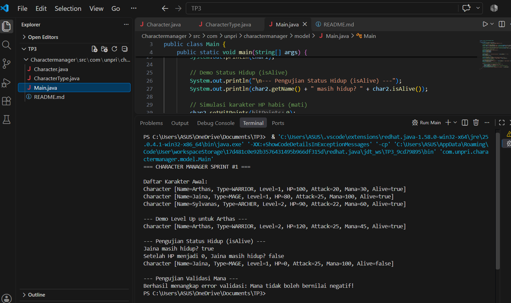
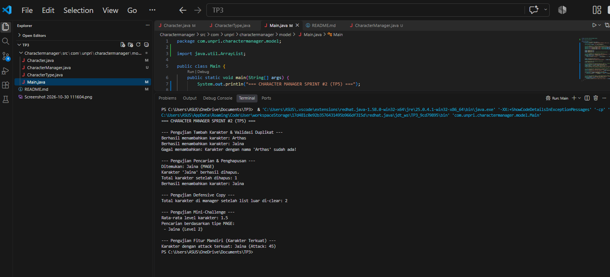
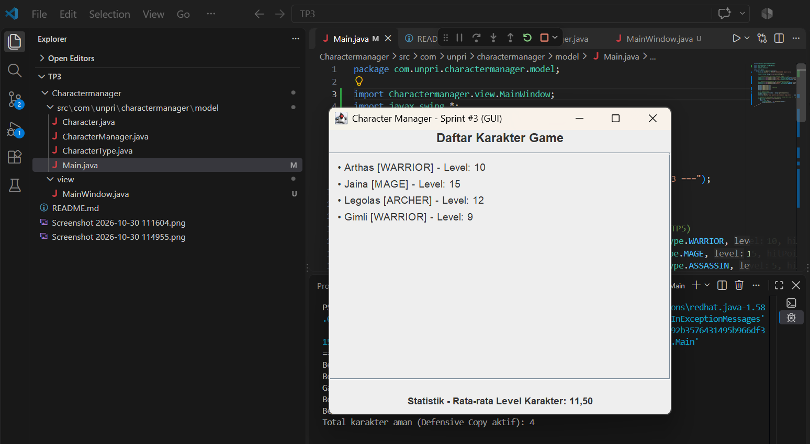
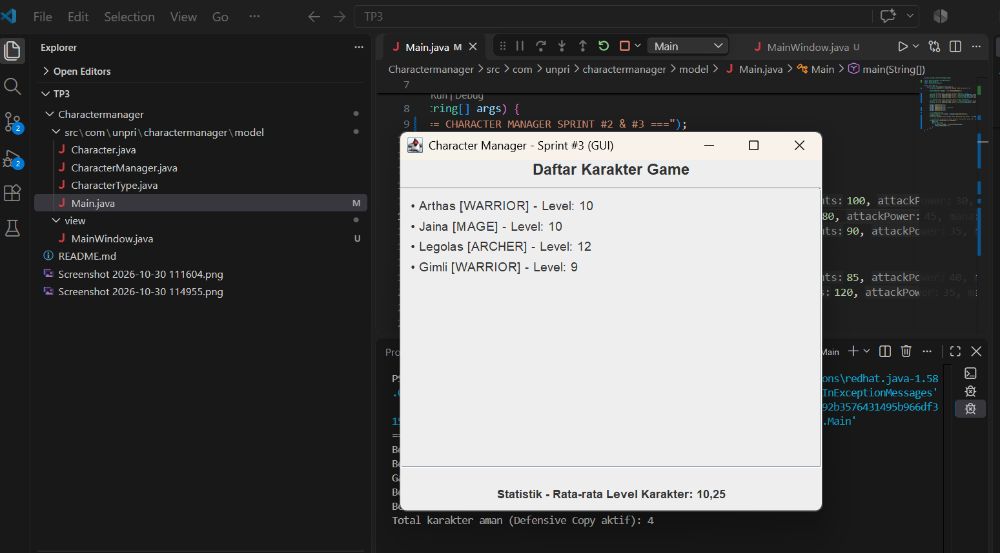
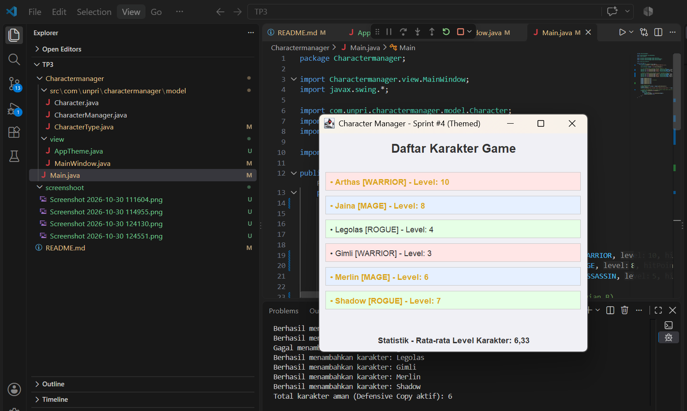

# Character Manager — TP3 (Java Visual SIH-6406)

## Deskripsi

Character Manager adalah program sederhana berbasis Java untuk mengelola karakter game. Program ini menerapkan konsep Object-Oriented Programming (OOP), seperti class, object, constructor, encapsulation, getter, setter, dan method. Program juga memiliki fitur pengelolaan mana dan pemeriksaan status kehidupan karakter.

## Fitur Program

- Membuat karakter dengan tipe WARRIOR, MAGE, ARCHER, dan HEALER.
- Menggunakan dua constructor.
- Mengatur level karakter.
- Menghitung hitPoints dan attack berdasarkan level.
- Menaikkan level menggunakan method levelUp().
- Mengatur mana menggunakan getMana() dan setMana().
- Memvalidasi agar mana tidak bernilai negatif.
- Memeriksa status kehidupan menggunakan isAlive().
- Menampilkan informasi karakter menggunakan toString().

## Struktur Folder

text
CharacterManager_TP3/
├── CharacterManager/
│   ├── src/
│   │   └── com/
│   │       └── unpri/
│   │           └── charactermanager/
│   │               ├── Main.java
│   │               └── model/
│   │                   ├── Character.java
│   │                   └── CharacterType.java
│   └── output-program.png
├── README.md
└── .gitignore

## Screenshot Output Program

## Screenshot Output Program

Screenshot menampilkan daftar tiga karakter, demo kenaikan level, pengaturan mana, dan hasil pemeriksaan isAlive().

## Identitas Mahasiswa

- *Nama:* Inggrid Kesia Timoty Siahaan
- *NIM:* 253303621223
- *Program Studi:* Sistem Informasi
- *Universitas:* Universitas Prima Indonesia
- *Mata Kuliah:* Java Visual (SIH-6406)

## Link Google Docs — Bagian D
   ( https://docs.google.com/document/d/11_jLyfLRsdpg9jiduk0TAVY9tez-n1Ho6KcA6v9v8Qo/edit?usp=sharing)
    

---
# TP5 — Character Manager Sprint #2

## Deskripsi TP5

TP5 merupakan pengembangan dari proyek TP3. Pada tahap ini, program dilengkapi dengan fitur pengelolaan data karakter menggunakan ArrayList, analisis level, pencarian berdasarkan tipe, serta pengujian object reference.

## Fitur TP5

### Part A — Character Manager

- Menambahkan karakter menggunakan addCharacter().
- Mencari karakter berdasarkan nama menggunakan findByName().
- Menghapus karakter menggunakan removeCharacter().
- Menghitung jumlah karakter menggunakan getTotalCharacters().
- Mengembalikan salinan daftar karakter menggunakan getAllCharacters().
- Menggunakan equals() untuk membandingkan karakter berdasarkan nama.
- Menolak penambahan karakter dengan nama duplikat.

### Part B — Analytics

- Menghitung rata-rata level menggunakan getAverageLevel().
- Mencari karakter berdasarkan tipe menggunakan findByType().
- Menggunakan atribut static untuk menghitung jumlah karakter yang berhasil ditambahkan.

### Part C — Fitur Mandiri

Fitur tambahan yang dibuat adalah findStrongest().

Method ini digunakan untuk mencari karakter dengan nilai attack tertinggi dari seluruh karakter yang tersimpan. Jika daftar karakter kosong, method mengembalikan null.

Fitur ini membantu pengguna mengetahui karakter yang memiliki kekuatan serangan paling tinggi.

## Screenshot Output TP5

### Screenshot 1 — Pengujian CRUD dan Analytics

Screenshot menampilkan hasil pengujian fitur Character Manager TP5, termasuk penambahan karakter, penolakan duplikat, equals, object reference, analytics, findStrongest, defensive copy, dan penghapusan karakter.

## Link Google Docs TP5 — Bagian D

https://docs.google.com/document/d/13hSDwnIG8a7Ov0VOPC_eHdDZhg9jHwwUnOaimDDaGIk/edit?usp=sharing
---

# TP8 — Character Manager Sprint #3

## Deskripsi TP8

TP8 merupakan pengembangan lanjutan dari proyek Character Manager dengan menerapkan konsep Graphical User Interface (GUI) menggunakan Java Swing. Program menampilkan daftar karakter secara dinamis melalui jendela aplikasi serta menyediakan informasi jumlah karakter dan rata-rata level.

## Part A — GUI Character Manager

Fitur yang dikembangkan:

- Membuat jendela aplikasi menggunakan JFrame.
- Menampilkan judul aplikasi Character Manager.
- Menampilkan daftar karakter menggunakan JLabel.
- Menggunakan JPanel untuk mengatur tata letak komponen.
- Menggunakan JScrollPane agar daftar karakter dapat digulir.
- Menampilkan data karakter secara dinamis menggunakan perulangan.
- Menjalankan GUI menggunakan SwingUtilities.invokeLater().

## Part B — Penambahan Karakter dan Statistik

Program menampilkan enam karakter:

1. Aragorn — WARRIOR
2. Merlin — MAGE
3. Legolas — ARCHER
4. Luna — HEALER
5. Thor — WARRIOR
6. Gandalf — MAGE

Dua karakter baru yang ditambahkan adalah:

- *Thor:* Karakter bertipe WARRIOR dengan level 6.
- *Gandalf:* Karakter bertipe MAGE dengan level 7.

Program juga menampilkan jumlah seluruh karakter dan rata-rata level karakter secara otomatis.

## Screenshot Output TP8

### Screenshot 1 — Sebelum Penambahan Karakter Kedua

### Screenshot 2 — Setelah Penambahan Karakter

Kedua screenshot memperlihatkan perubahan jumlah karakter dan statistik rata-rata level setelah penambahan karakter.

## Alur Program dan Konsep MVC

Alur program dimulai dari Main.java yang membuat data karakter dan mengirimkannya kepada CharacterManager untuk dikelola. Selanjutnya, MainWindow menerima daftar karakter tersebut dan menampilkannya menggunakan komponen Java Swing. CharacterManager berperan sebagai bagian dari Model yang mengelola data karakter, sedangkan MainWindow berperan sebagai View yang bertanggung jawab menampilkan informasi kepada pengguna. Dengan demikian, pengelolaan data dan tampilan program dipisahkan agar struktur aplikasi lebih terorganisasi.

## Link Google Docs TP8 — Bagian D

https://docs.google.com/document/d/1M-v6doGdfqnQ0NEMCx8Ey3ILHAQBNoUcCoRtws6SAnQ/edit?usp=sharing

## TP10 / AP13 — Character Manager Sprint #4

### A. Theme Application

Pada Sprint #4, aplikasi Character Manager dikembangkan menggunakan AppTheme.java untuk mengatur warna, font, dan border secara terpusat.

Warna kartu karakter dibedakan berdasarkan role, yaitu Warrior, Mage, Archer, dan Healer. Karakter dengan level 5 atau lebih ditampilkan menggunakan tulisan berwarna emas dan tebal.

### B. Additional Component Properties

Dua properti tambahan yang diterapkan:

1. *ToolTipText*: Menampilkan informasi nama, role, dan level karakter ketika kursor diarahkan ke kartu karakter.
2. *setEnabled()*: Mengatur status kartu karakter. Karakter level 1 dibuat nonaktif, sedangkan karakter dengan level selain 1 tetap aktif.

### C. Before and After Screenshots

### C. Before and After Screenshots

*After v0.4 (Tampilan Saat Ini dengan Tema Warna dan Border)*

> **Catatan (Before v0.3):** Pada versi v0.3 sebelumnya, tampilan aplikasi masih menggunakan teks standar (*plain text*) berwarna hitam biasa tanpa panel latar belakang berwarna per role dan tanpa *border* kartu.

### D. Alasan Penggunaan AppTheme

Warna dan font diletakkan di dalam AppTheme agar pengaturan tampilan aplikasi terpusat. Dengan demikian, perubahan warna atau font dapat dilakukan tanpa mengubah banyak bagian kode pada MainWindow. Selain itu, pemisahan ini membuat kode lebih rapi dan mudah dipelihara. Character tetap berfokus pada data karakter, bukan pengaturan tampilan antarmuka.

### E. Google Docs Analysis

Link analisis MVC TP10:
https://docs.google.com/document/d/1T1KHMk4myne4Tzwl3M9aCEUVkKMdojUWbj3zKUaZ6WU/edit?usp=sharing
